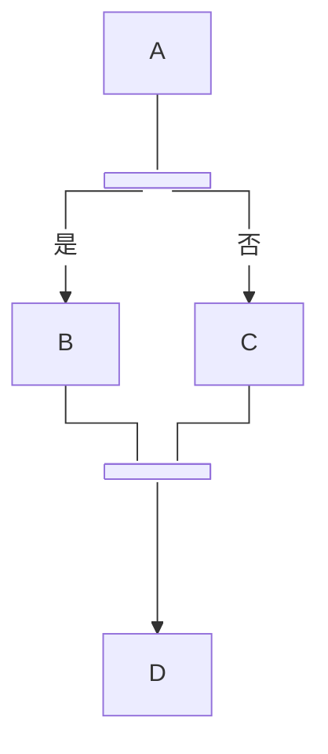
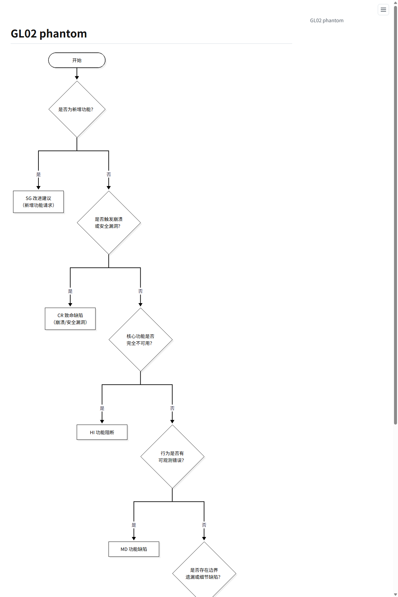
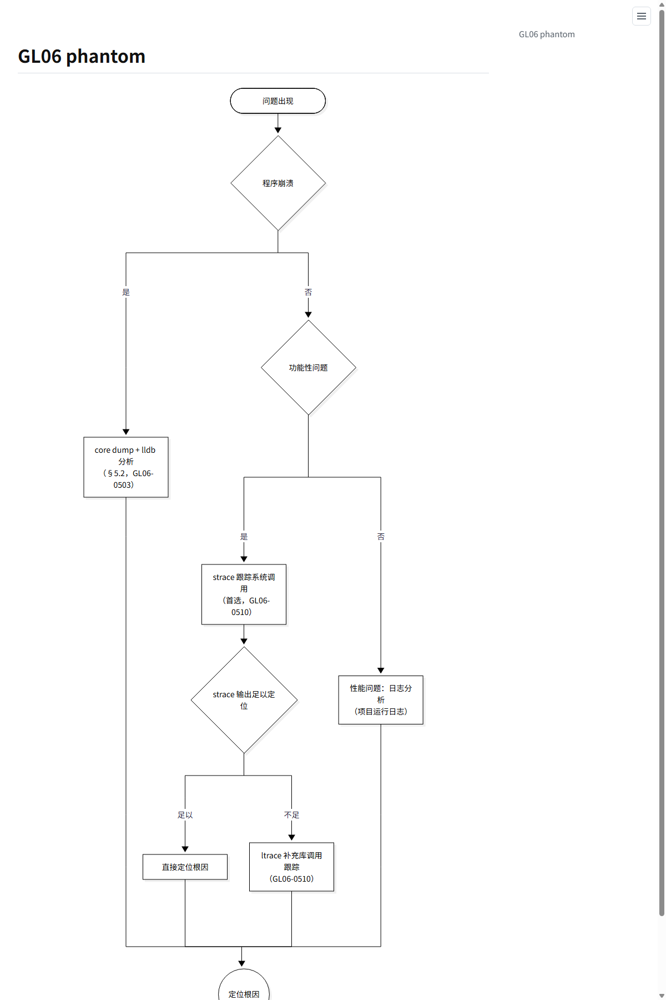
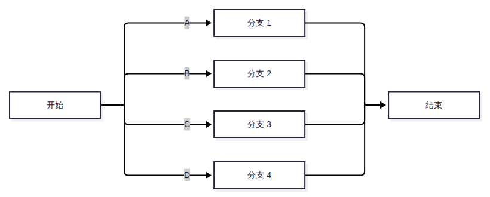

# Mermaid invisible-gateway patch（phantom fork/join + explicit curves）

- 日期：2026-10-30
- 结论：**接受对 `mermaid.min.js` 打补丁**。下游 mdview 的 vendor 是 12.2.0 + 补丁，不是 stock 构建。
- 分支：`mdview/invisible-gateway-12.2.0`（基于 Mermaid 12.2.0 commit `1fb7869866dd619168d840291c9c54b4f129758b`）
- 补丁：`patches/mermaid-12.2.0-invisible-gateway.patch`
- 补丁 SHA-256：`d94b9f5bb91223bf1033e40e452095e15a22b9f46c683c9ba4dcfcc0c05e4e00`
- 下游 vendor SHA-256（mdview 构建）：`6ccfc2ac184fe14a3e86f595a85ac91a693fd907af3dd8ce153f4a6e212da7ae`

## 1. 为什么必须 patch

目标效果是：**fork/join 网关语义显式、视觉完全隐形（0×0），边为锐利直角折线**。stock Mermaid 12.2.0 有三处阻断：

1. `shape: fork/join` 是原生可见横条，有自己的 bbox 和 `intersect`。即使把尺寸缩到 0×0，仍会按条形边界绕行，2 路分叉出现双竖线/小钩子。
2. `classDef` 的 `width` / `height` 只是 CSS，不参与布局；不能用样式把网关压成 0×0。单纯的 `opacity: 0` / `visibility: hidden` 也只影响绘制，节点仍占布局空间，边仍按条形 bbox 绕行。
3. 12.2 默认 `layout: elk`。ELK 渲染器在 `applyElkEdgeLayout` 中无条件写 `curve = 'rounded'`，并且在 `buildEdgeData` 里把曲线名转换成 d3 函数；`insertEdge` 只接受字符串曲线名，于是显式 `flowchart.curve` / 单边 `curve` 被静默丢弃。

因此补丁做两件事：

- 给节点增加 `phantom: true` 属性：节点保留在布局/路由中，但 0×0、不绘制；
- 恢复 ELK 对显式曲线的尊重。

## 2. 补丁内容

补丁基于 Mermaid 12.2.0（上游源码 commit `1fb7869`），共 8 个文件：

| 文件 | 修改 |
| --- | --- |
| `diagrams/flowchart/flowDb.ts` | 解析节点 metadata 的 `phantom: true` 并记录到 `FlowVertex`；传给布局节点。给边记录 `curveExplicit`。 |
| `diagrams/flowchart/types.ts` | `FlowVertex` 增加 `phantom`。 |
| `types.ts` | `NodeMetaData` 增加 `phantom`。 |
| `rendering-util/types.ts` | `BaseNode` 增加 `phantom`；`Edge` 增加 `curveName` / `curveExplicit`。 |
| `rendering-util/rendering-elements/nodes.ts` | `insertNode` 遇到 `node.phantom`：label 清空、尺寸 0×0、不调用 shape handler、`intersect` 返回节点中心，只创建一个空 `<g>`。 |
| `rendering-util/rendering-elements/edges.js` | 0×0 网关的边折叠为经过共享总线的单 L：TD 用水平总线（`node.y`），LR 用垂直总线（`node.x`）；出线/入线共用总线，避免交叉触发行跳（hooks）；`step` 系列曲线跳过 `fixCorners`。 |
| `rendering-util/layout-algorithms/elk/render.ts` | `buildEdgeData` 保留原始曲线名 `curveName`；`applyElkEdgeLayout` 在布局后恢复曲线名。只有“没有显式指定曲线”时才回退到 ELK 默认的 `rounded`。 |
| `config.ts` | `hasExplicitFlowchartCurve()`：区分 schema 默认值 `basis` 与用户通过 `initialize` / frontmatter / `%%{init}%%` 显式写的值。 |

补丁**不**把 `shape: fork/join` 映射成 `rect`；节点类型始终是原生 fork/join，`phantom` 只控制布局尺寸和绘制。原生可见横条（不加 `phantom`）完全不受影响。

## 3. 曲线语义（最终行为）

| 写法 | 结果 |
| --- | --- |
| 不写 `curve` | ELK 默认 `rounded`（圆角折线） |
| `%%{init: {'flowchart': {'curve': 'stepAfter'}}}%%` | 全部边直角折线 |
| frontmatter `config.flowchart.curve: stepAfter` | 同上 |
| `mermaid.initialize({ flowchart: { curve: 'stepAfter' } })` | 同上（宿主级配置） |
| `curve: 'rounded'` | 圆角 |
| `curve: 'basis'` / `'linear'` / `'natural'` / … | 按指定曲线渲染 |
| 单边 `A e1@--> B` + `e1@{ curve: 'linear' }` | 单边覆盖，优先级最高 |

验证矩阵（Chrome headless，实际 SVG path 检查）：

```text
default      -> Q（rounded）
stepAfter    -> L（纯直角）
rounded      -> Q
basis        -> C（平滑曲线）
per-edge     -> linear / rounded / basis 分别生效
frontmatter  -> stepAfter 生效
initialize   -> stepAfter 生效
```

## 4. fork/join 源文档写法



- `phantom: true` 表示：节点存在于布局和连线路由中，但 0×0、不绘制 bar/label。
- 不需要 `fork_node` / `join_node` class，也不需要透明 classDef；`phantom` 是节点级属性，不依赖 class。
- 不加 `phantom` 时，`shape: fork/join` 按 Mermaid 原生可见横条渲染，适合 UML 并发条。
- 入边用 `---`（无箭头）；出边用 `-- 标签 -->`。
- 3 路以上分叉、2–4 路汇合已验证为单点 T 形；更多路汇合建议实际检查，必要时分两级。

## 5. 构建与升级

在本仓库构建打过补丁的运行时：

```bash
git clone https://github.com/kayven1981/mermaid.git
cd mermaid
git checkout mdview/invisible-gateway-12.2.0
pnpm install --frozen-lockfile
pnpm build:mermaid
# 产物：packages/mermaid/dist/mermaid.min.js
```

如果从干净 upstream 源码构建，等价步骤：

```bash
git clone https://github.com/mermaid-js/mermaid.git
cd mermaid
git checkout 1fb7869866dd619168d840291c9c54b4f129758b
git apply /path/to/patches/mermaid-12.2.0-invisible-gateway.patch
pnpm install --frozen-lockfile
pnpm build:mermaid
```

`scripts/apply-mdview-patch.sh` / `scripts/verify-mdview-patch.sh` 可在干净
12.2.0 worktree 上应用或检查补丁。

升级 Mermaid 时：

1. 先在新版本上尝试 `git apply --check`；冲突则按第 2 节的 8 处 hunk 重新移植。
2. 重跑第 3 节的曲线矩阵。
3. 重跑 GL02 / GL06 实际页面，检查 2 路/多路 fork、4 路 join、直角/圆角。
4. 更新本文档中的源码 commit、补丁 SHA、下游 vendor SHA。

## 6. 验证记录

实际 mdview 页面（`mdview render --format html` + Chrome）的证据图：

- `docs/evidence/mermaid-gl02-patched.png`：GL02 决策树，2 路 fork 为单线 T 形，纯直角。
- `docs/evidence/mermaid-gl06-patched.png`：GL06 功能验证图，3 个 2 路 fork 干净；底部 4 路 join 为水平总线 + 单点，无 ladder/回环。
- `docs/evidence/mermaid-lr-fork-join.png`：LR 4 路 fork/join，垂直共享总线 + 水平分支；修复前 branch 2 的 `A6,6` 行跳已消失。







2026-10-30 LR 修复：旧 `snapStart/End` 只把 ELK 的首/末折点拉到网关坐标，4 路 LR 扇出仍保留各自竖线；竖线与相邻分支的水平入线交叉，Mermaid 的 line-jump 画成 `A6,6` 半圆，看起来像钩子。现改为“共享总线单 L”：TD 水平总线、LR 垂直总线，所有平行段重叠、不再交叉，因此不会触发行跳。

验证：Playwright/Chromium 直接加载 mdview 生成的 `showcase.md` 页面，3 个 Mermaid block 渲染无错误；LR 4 路 fork 的 SVG 路径为 `M... L...` 共享总线，无 `A6,6` 行跳；TD GL02/GL06 路径无回归。

Mermaid 源码测试（补丁后）：

```text
flowDb.spec.ts              32 passed
layout-algorithms/elk       162 passed（8 files）
```

补丁适用性：

```text
git apply --check  -> OK（在 12.2.0 干净 worktree 上验证）
```

## 7. 已知限制

- 补丁只针对 12.2.0；其他版本需要重新移植。
- 共享总线单 L 已在 TD/LR 的 2 路和 4 路 fork/join 上验证；5 路以上仍建议实际检查（总线重叠段更长）。
- `phantom` 节点之间直接互连（fork 出线直接进 join）仍不建议：出线带箭头、入线要求无箭头，语义/路由都容易冲突，按 skill 用普通节点过渡。
- `phantom` 是节点级属性：目前只实现了 0×0 + 不绘制 + 中心 intersect；不提供任意 `width`/`height` 的通用尺寸 API。
- 宿主如果全局 `mermaid.initialize({ flowchart: { curve: ... } })`，该值会成为所有图的默认值；需要单图不同曲线时在块内用 `%%{init}%%` 或单边 `curve` 覆盖。

## 8. 相关位置

- 下游使用方：[mdview](https://github.com/kayven1981/mdview)
- 上游：[mermaid-js/mermaid](https://github.com/mermaid-js/mermaid)
- 本仓库补丁：`patches/mermaid-12.2.0-invisible-gateway.patch`
- 证据图：`docs/evidence/`
